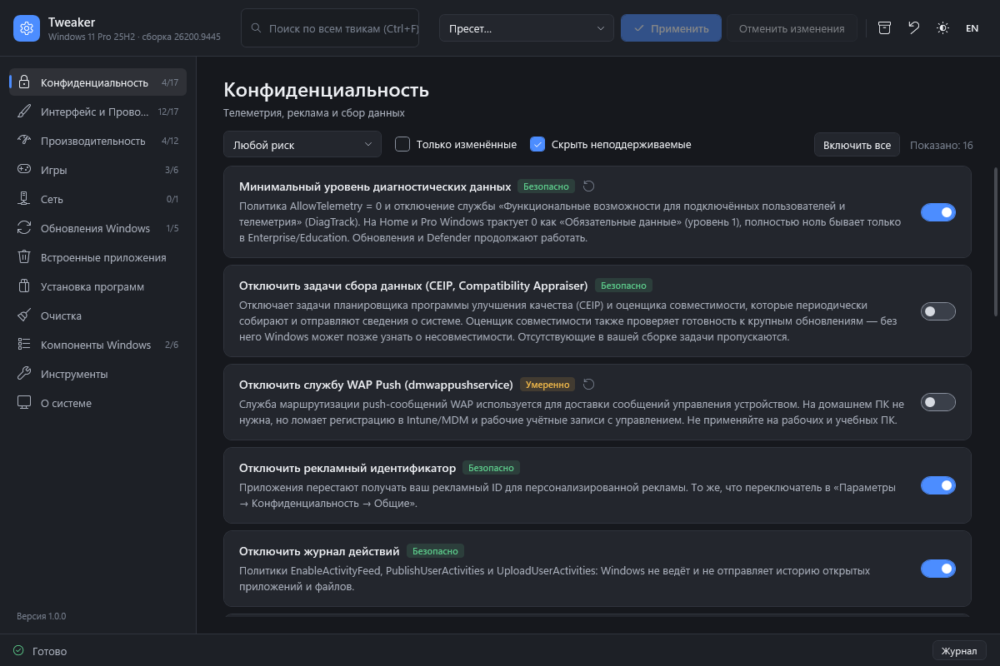

# Tweaker

**Настройка Windows 10 и 11 в один клик — безопасно и с откатом любого изменения.**

Отключает телеметрию и рекламу, делает Проводник удобнее, ускоряет систему, удаляет ненужные встроенные приложения, ставит программы и чистит диск. Каждое изменение сначала сохраняется в бэкап, поэтому всё можно вернуть как было.



## Как запустить

1. Нажмите **Win + X** и выберите **«Терминал (администратор)»** (в Windows 10 — **«Windows PowerShell (администратор)»**).
2. Вставьте эту команду и нажмите **Enter**:

```powershell
irm https://raw.githubusercontent.com/ninn1ku/Tweaker/main/launch.ps1 | iex
```

Откроется окно Tweaker. Ничего устанавливать не нужно. Если вы открыли обычное (не админское) окно — ничего страшного: Tweaker сам попросит права администратора. Если отказаться, он откроется в **режиме просмотра** — можно посмотреть, что настроено, но ничего не изменится.

<details>
<summary>Другие способы запуска</summary>

- Напрямую последний релиз:
  ```powershell
  irm https://github.com/ninn1ku/Tweaker/releases/latest/download/Tweaker.ps1 | iex
  ```
- Скачать `Tweaker.ps1` со страницы [Releases](https://github.com/ninn1ku/Tweaker/releases), нажать на файл правой кнопкой → «Выполнить с помощью PowerShell».
- Только посмотреть, без прав администратора: `.\Tweaker.ps1 -ReadOnly`.

</details>

## С чего начать

1. Слева выберите раздел, например «Конфиденциальность». Тумблеры показывают, что **уже** включено в вашей системе.
2. Проще всего выбрать вверху пресет **«Рекомендуемый»** — он отметит только безопасные твики. Ничего не применяется, пока вы не нажмёте кнопку.
3. Нажмите **«Применить»**. Tweaker покажет сводку: что изменится, есть ли риски, нужна ли перезагрузка. Перед первым изменением он создаёт **точку восстановления**.

Значки у твиков: **«Безопасно»** — можно всем; **«Умеренно»** — есть компромисс, прочтите описание; **«Для опытных»** — только если понимаете последствия (перед применением будет отдельное предупреждение). Наведите курсор на карточку — увидите, какие именно параметры меняются и ссылку на документацию.

## Частые вопросы

**Это безопасно?**
Tweaker меняет только то, что описано в карточке, и только после вашего подтверждения. Он не отключает Защитник Windows, UAC и SmartScreen, не удаляет Edge, Microsoft Store и системные компоненты, не трогает файлы в System32, ничего не активирует и не собирает о вас данные. Код открыт — его можно прочитать целиком; все твики описаны в [docs/TWEAKS.md](docs/TWEAKS.md) со ссылками на документацию Microsoft.

**Как всё вернуть обратно?**
- Выключите тумблер нужного твика и нажмите «Применить» — вернётся **ваше прежнее значение**, а не «какое-то по умолчанию».
- Кнопка **«Откат…»** (стрелка вверху) — откатить целый сеанс или **все изменения Tweaker** разом.
- В крайнем случае — точка восстановления Windows (Tweaker создаёт её автоматически).

Бэкапы лежат в `C:\ProgramData\Tweaker\backups`, журнал действий — в `C:\ProgramData\Tweaker\logs`.

**Антивирус ругается.**
Скрипты, которые меняют настройки Windows, иногда помечаются эвристикой как «подозрительные». Tweaker не скачивает исполняемые файлы, не обфусцирован и не прячется. Можно проверить его [на VirusTotal](https://www.virustotal.com/) или прочитать исходный код в папке `src`. Если сомневаетесь — сначала попробуйте в песочнице (ниже).

**Почему команда начинается с `irm … | iex`?**
Это стандартный способ запустить скрипт из интернета: `irm` скачивает текст, `iex` выполняет. Лаунчер берёт файл только из этого репозитория на GitHub и запускает его с `-ExecutionPolicy Bypass` **только для этого процесса** — системная политика выполнения не меняется.

**Что делать, если что-то пошло не так после применения?**
Откройте Tweaker снова → «Откат…» → «Полный откат». Если Windows не загружается — используйте точку восстановления из среды восстановления Windows.

## Попробовать без риска: Windows Sandbox

Песочница — одноразовая копия Windows: всё, что вы там поменяете, исчезнет после закрытия окна. Есть в Windows 10/11 Pro, Enterprise и Education.

1. Включите компонент: Tweaker → «Компоненты Windows» → «Песочница Windows» (или «Включение или отключение компонентов Windows» → «Песочница Windows») и перезагрузитесь.
2. Скачайте файл [docs/Tweaker-Sandbox.wsb](docs/Tweaker-Sandbox.wsb) и откройте его двойным щелчком — песочница запустится и сама откроет Tweaker.
3. Применяйте что угодно, проверяйте результат, закройте окно — ваша настоящая система не изменится.

## Возможности

| Раздел | Что внутри |
|---|---|
| Конфиденциальность | Телеметрия, рекламный ID, журнал действий, реклама в Пуске и на экране блокировки, Bing в поиске, Copilot, Recall, виджеты, отзывы, геолокация |
| Интерфейс и Проводник | Классическое контекстное меню, панель задач слева, «Завершить задачу», секунды в часах, расширения файлов, тёмная тема и др. |
| Производительность | «Максимальная производительность», гибернация и быстрый запуск, анимации, фоновые приложения, SysMain, индексирование |
| Игры | Игровой режим, Game DVR, HAGS, ускорение мыши |
| Сеть | DNS-пресеты (Cloudflare, Google, Quad9, AdGuard) с DoH, P2P-раздача обновлений, сброс DNS-кэша |
| Обновления Windows | «Только безопасность», пауза, без драйверов, без авто-перезагрузки |
| Встроенные приложения | Удаление рекламных и ненужных приложений; Store, WinGet, системные компоненты и Edge защищены |
| Установка программ | Популярные программы через WinGet, «обновить всё» |
| Очистка | Временные файлы, кэш обновлений, корзина, DISM — с оценкой места до и после |
| Компоненты Windows | WSL, Hyper-V, Песочница, .NET 3.5, отключение SMB1 и PowerShell 2.0 |
| Инструменты | SFC, DISM, сброс Центра обновления и сети, классические панели, точки восстановления, экспорт/импорт настроек |
| О системе | Windows, процессор, видеокарта, память, диски, сохранение отчёта |

Интерфейс на русском и английском (кнопка **EN/RU**), тёмная, светлая и системная темы.

## Командная строка

Без параметров открывается окно. С параметрами Tweaker работает как консольная утилита:

```powershell
.\Tweaker.ps1 -List                                  # все твики
.\Tweaker.ps1 -Status -Category privacy               # текущее состояние
.\Tweaker.ps1 -Preset recommended -WhatIf             # пробный прогон пресета
.\Tweaker.ps1 -Apply privacy.disable-telemetry,interface.show-file-extensions
.\Tweaker.ps1 -Undo Last                              # откатить последний сеанс (All — всё)
.\Tweaker.ps1 -Export my.json ; .\Tweaker.ps1 -Import my.json
```

Параметры: `-Preset`, `-Apply`, `-Undo <id,...|Last|All>`, `-List`, `-Status`, `-Category`, `-Export`, `-Import`, `-WhatIf`, `-Silent`, `-Lang ru|en`, `-ReadOnly`, `-NoElevate`, `-NoRestorePoint`, `-DefaultUser`.
Коды выхода: `0` — успех, `1` — часть шагов с ошибкой, `2` — неверные аргументы, `3` — нужны права администратора, `4` — GUI недоступен, `5` — непредвиденная ошибка.

Через `irm` с параметрами: `& ([scriptblock]::Create((irm https://github.com/ninn1ku/Tweaker/releases/latest/download/Tweaker.ps1))) -Status`.

## Требования

Windows 10 22H2 или Windows 11 23H2 / 24H2 / 25H2, встроенный Windows PowerShell 5.1 (PowerShell 7 тоже поддерживается). Больше ничего не нужно.

## Для разработчиков

```powershell
./build/Build.ps1                 # собрать dist/Tweaker.ps1 и docs/TWEAKS.md
./build/Test.ps1 -InstallTools    # один раз: Pester 5 и PSScriptAnalyzer
./build/Test.ps1                  # анализатор + тесты (система не меняется: всё на моках)
```

- Твики — это данные: `config/tweaks/<категория>.json`, формат описан схемой `config/schema/tweaks.schema.json`. Новый твик = новая запись в JSON (с `undo`, источником и текстами на `ru`/`en`).
- Код в `src/` — только ASCII; все строки интерфейса — в `config/lang`.
- Сборка кладёт всё в один ASCII-файл `dist/Tweaker.ps1` (ресурсы в Base64), поэтому кириллица не ломается при `irm | iex`.
- Релиз: тег `v*` → GitHub Actions публикует `Tweaker.ps1` и `launch.ps1`; каждый push в `main` обновляет пре-релиз `nightly`.
- Во время разработки не применяйте твики к своей системе — используйте `-WhatIf`, `-ReadOnly` и песочницу.

## Лицензия

MIT — см. [LICENSE](LICENSE).
